<p align="center">
  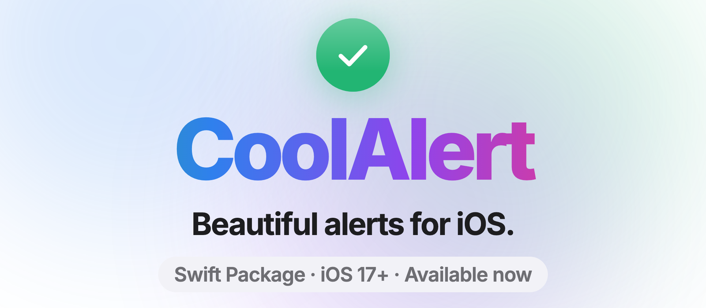
</p>

<p align="center">
  <a href="https://github.com/Batchhh/CoolAlert/actions/workflows/ci.yml"></a>
  
  
  
  <a href="LICENSE"></a>
</p>

<p align="center">
  Animated, accessible alerts for UIKit and SwiftUI. One line to show, a chain to customize.
</p>

```swift
CoolAlert.success("Payment sent", "€42.00 is on its way to Alex.")
```

<p align="center">
  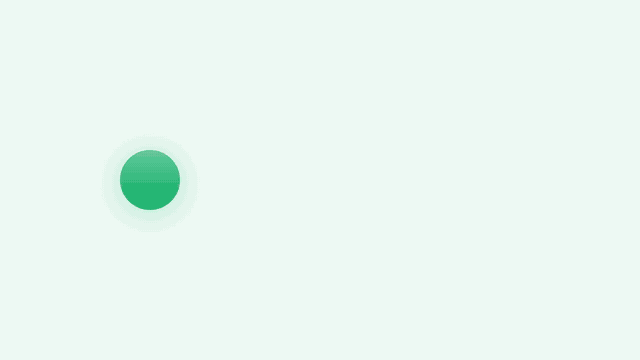
</p>

## Gallery

| Success | Destructive | Async + validation | Progress |
|:---:|:---:|:---:|:---:|
| 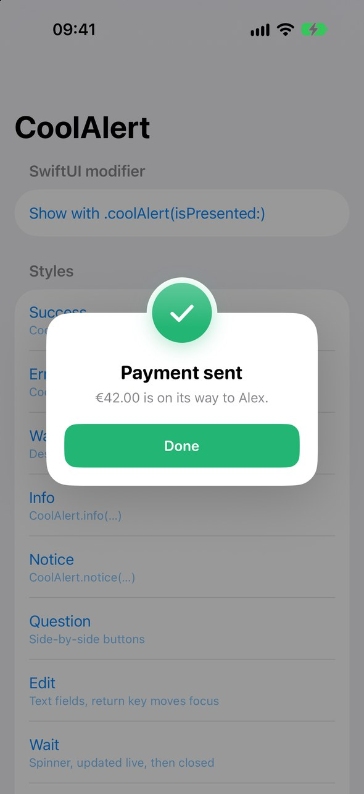 | 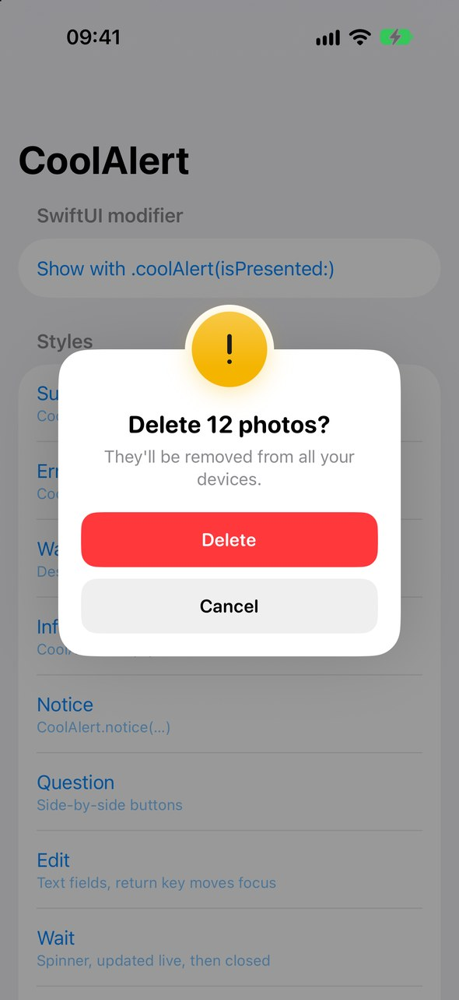 | 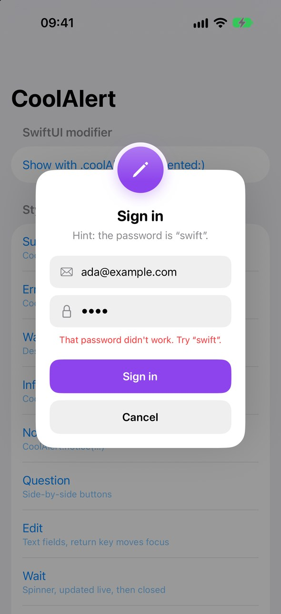 | 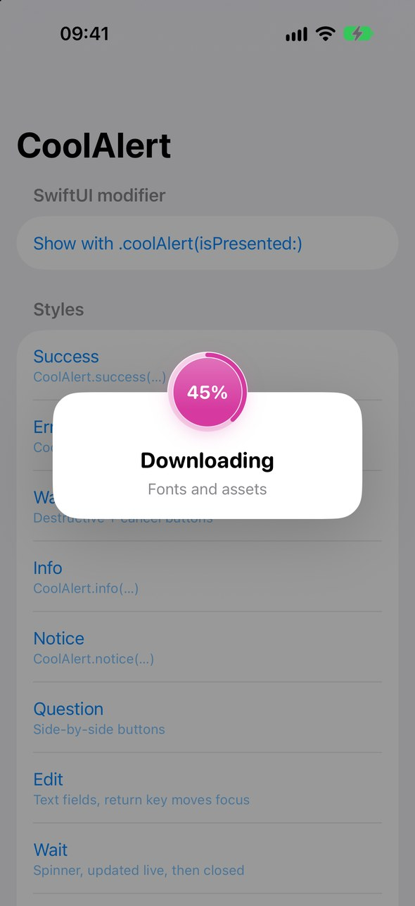 |
| **Liquid Glass** | **Many buttons** | **SwiftUI content** | **Custom style** |
| 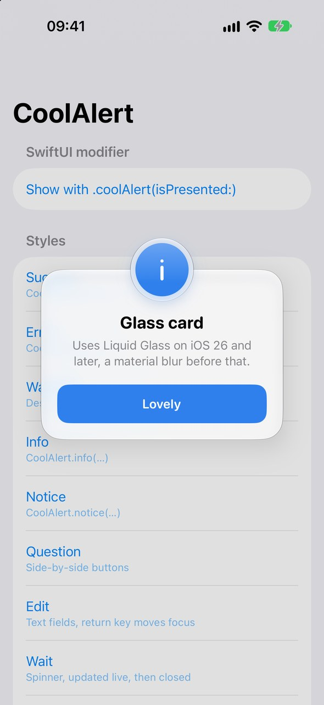 | 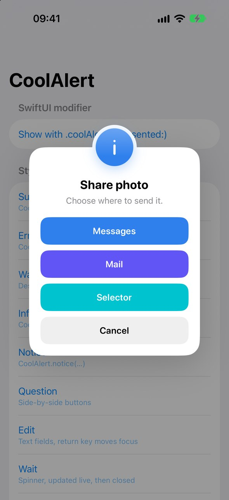 | 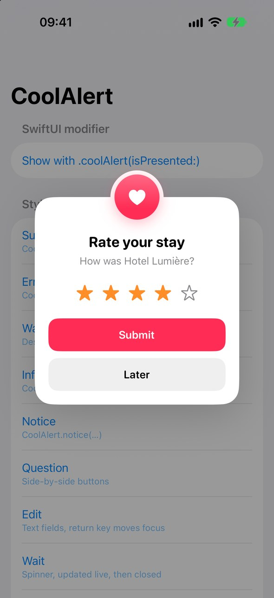 | 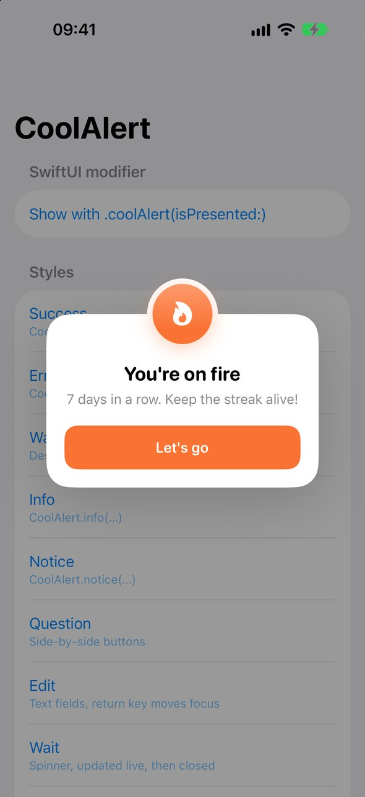 |
| **Dark mode** | **Side-by-side buttons** | **Fields with icons** | |
| 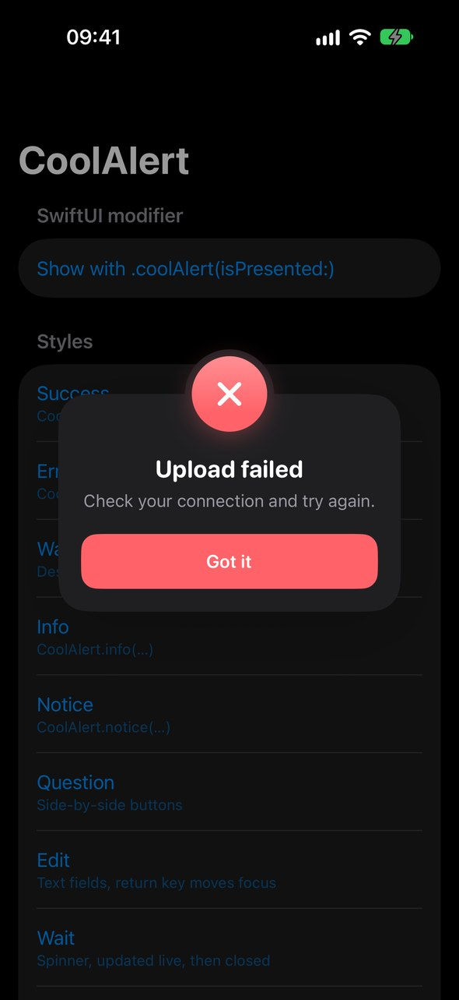 | 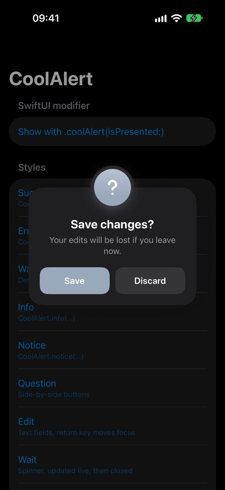 | 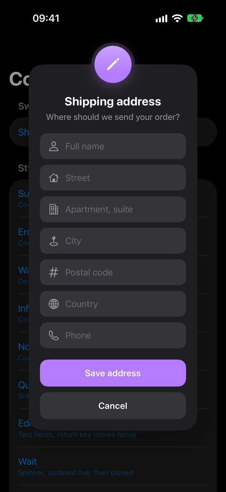 | |

## Features

- **Nine styles:** success, error, warning, info, notice, question, edit, wait, and custom. Each has its own color and an icon that draws itself in.
- **Easy syntax:** one-liners for common cases, a chainable builder for everything else, and `async`/`await` when you need the answer.
- **Buttons:** default, cancel and destructive roles, custom colors, target/selector, and a live countdown on the button.
- **Async actions:** the button shows a spinner while the work runs. If it throws, the error appears inline and the alert shakes.
- **Input:** text fields with leading icons, text views, validation that enables buttons, and return-key navigation.
- **Your own content:** any `UIView` or SwiftUI view.
- **Timeouts and progress:** auto-dismiss with a draining bar, and a progress ring with a percentage.
- **Motion:** seven entrance animations, UIKit Dynamics, swipe to dismiss, and haptics.
- **Liquid Glass** cards on iOS 26+, with a material fallback on earlier versions.
- **Queueing:** show alerts one at a time instead of stacking them.
- **Built for everyone:** VoiceOver, Dynamic Type, Reduce Motion, light and dark mode, and keyboard avoidance. Tall content scrolls in any orientation.

## Installation

**Swift Package Manager.** In Xcode, choose **File › Add Package Dependencies…** and enter:

```
https://github.com/Batchhh/CoolAlert.git
```

Or add it to `Package.swift`:

```swift
dependencies: [
    .package(url: "https://github.com/Batchhh/CoolAlert.git", branch: "main")
],
targets: [
    .target(name: "MyApp", dependencies: ["CoolAlert"])
]
```

Requires iOS 17+ and Xcode 26+ (Swift 6).

## Quick start

```swift
import CoolAlert

CoolAlert.success("Saved")
CoolAlert.error("Upload failed", "Check your connection.", closeButton: "Got it")
CoolAlert.warning("Low storage", timeout: 3)
CoolAlert.info("New in 2.0", "Swipe left on any message to snooze it.")
```

For anything more, build the alert, then call `show()`:

```swift
CoolAlert(.warning, "Delete 12 photos?", "They'll be removed from all your devices.")
    .button("Delete", role: .destructive) { deletePhotos() }
    .closeButton("Cancel")
    .show()
```

You don't need to keep a reference: an alert stays alive while it's on screen.

## Usage

### Waiting for the answer

```swift
let result = await CoolAlert(.question, "Enable notifications?")
    .button("Enable")
    .closeButton("Not now")
    .present()

switch result {
case .button(let index, let title): …   // one of your buttons, by position
case .dismissed: …                      // close button, background tap, swipe, or close()
case .timeout: …
}
```

Cancelling the task closes the alert.

### Buttons

```swift
CoolAlert(.info, "Share photo")
    .button("Messages") { … }                                  // accent color
    .button("Mail", backgroundColor: .systemIndigo) { … }
    .button("Report", role: .destructive) { … }
    .button("Legacy", target: self, selector: #selector(legacy))
    .closeButton("Cancel")                                     // nil or .hideCloseButton() to hide it
    .appearance { $0.buttonsLayout = .automatic }              // .vertical / .horizontal / .automatic
    .show()
```

### Async actions and validation

```swift
let alert = CoolAlert(.edit, "Sign in")
let email = alert.addTextField("Email", systemImage: "envelope")
let password = alert.addTextField("Password", systemImage: "lock")
password.isSecureTextEntry = true

alert
    .validate { email.text?.contains("@") == true && !(password.text ?? "").isEmpty }
    .button("Sign in") { try await api.signIn(email.text!, password.text!) }
    .closeButton("Cancel")
    .show()
```

While the action runs:

- the button shows a spinner
- the other buttons and the fields are disabled
- the timeout stops

If the action throws, the alert stays open, shows the error message in red and shakes. Editing a field clears the error. You can also show an error yourself with `alert.showError("Wrong code")`.

### Text input

```swift
let name = alert.addTextField("Name", systemImage: "person")   // SF Symbol, or icon: UIImage
let notes = alert.addTextView()

CoolAlert(.edit, "Rename").textField("Name", text: file.name) { $0.clearButtonMode = .always }
```

Return moves to the next field. On the last field, it taps the first action button. The card stays clear of the keyboard.

### Custom content

```swift
CoolAlert(.info, "Stay signed in?").customView(rememberMeRow).show()

CoolAlert(.custom(color: .systemPink), "Rate your stay")
    .icon(systemName: "heart.fill")
    .customView { StarRating() }        // any SwiftUI view
    .show()
```

### Updating a visible alert

```swift
let alert = CoolAlert.wait("Downloading").progress(0)
alert.progress = 0.42          // the ring fills; wait alerts show "42%"
alert.message = "Almost there"
alert.close()
```

### Timeouts

```swift
CoolAlert(.notice, "Ad break")
    .button("Skip", countdown: .seconds) { … }     // "Skip (5s)", "Skip (4s)", …
    .hideCloseButton()
    .timeout(5) { print("timed out") }
    .onDismiss { … }
    .show()
```

### Dismissing and queueing

- **Swipe to dismiss:** the user can fling an alert away when it can already be dismissed without choosing an action. Turn it off with `appearance.swipeToDismiss = false`.
- **Background tap:** set `appearance.hideWhenBackgroundViewIsTapped = true` to close the alert when the user taps outside it.
- **Queueing:** with `CoolAlert.queuesAlerts = true`, alerts appear one at a time instead of stacking.
- **Closing everything:** `CoolAlert.dismissAll()` closes every alert on screen and clears the queue.

### SwiftUI

```swift
.coolAlert(isPresented: $saved) {
    CoolAlert(.success, "Saved")
}

.coolAlert(item: $failedUpload) { upload in
    CoolAlert(.error, "Couldn't upload \(upload.name)")
}
```

## Customization

```swift
// Every alert
CoolAlert.defaultAppearance = .init {
    $0.titleFont = UIFont(name: "AvenirNext-Bold", size: 20)!
    $0.buttonCornerRadius = 24
    $0.hideWhenBackgroundViewIsTapped = true
}

// One alert
CoolAlert(.success, "Level complete")
    .color(hex: 0x39D98A)
    .icon(UIImage(named: "trophy"), tint: .white)
    .animation(.bottomToTop)   // .topToBottom .leftToRight .rightToLeft .fade .zoom .noAnimation
    .appearance {
        $0.cardStyle = .glass
        $0.dynamicAnimatorActive = true
    }
    .show()
```

<details>
<summary><b>All <code>Appearance</code> properties</b></summary>

| Group | Properties |
|---|---|
| Backdrop | `dimOpacity`, `backgroundBlur`, `hideWhenBackgroundViewIsTapped` |
| Card | `cardStyle`, `windowWidth`, `contentViewColor`, `contentViewBorderColor`, `contentViewBorderWidth`, `contentViewCornerRadius`, `shadowOpacity`, `margin` |
| Icon | `showCircularIcon`, `circleSize`, `circleRingWidth`, `circleTopPosition`, `circleIconSize`, `circleBackgroundColor`, `animatedIcons`, `activityIndicatorStyle` |
| Text | `titleFont`, `titleColor`, `titleMinimumScaleFactor`, `messageFont`, `messageColor`, `messageAlignment`, `maxMessageHeight` |
| Inputs | `textFieldHeight`, `textViewHeight`, `fieldCornerRadius`, `fieldFont`, `focusFirstField` |
| Buttons | `buttonFont`, `buttonHeight`, `buttonCornerRadius`, `buttonsLayout`, `showCloseButton`, `shouldAutoDismiss` |
| Behavior | `dynamicAnimatorActive`, `swipeToDismiss`, `disableTapGesture`, `hapticFeedback`, `showTimeoutProgress` |

`Margin` has `top`, `titleTop`, `titleToMessage`, `textViewBottom`, `buttonSpacing`, `textFieldSpacing`, `bottom` and `horizontal`.

</details>

## Accessibility

- **VoiceOver:** each alert is announced when it appears, and VoiceOver focus stays inside it until it closes. Inline errors are announced too. The escape gesture closes alerts the user could otherwise dismiss.
- **Dynamic Type:** the default fonts scale with the user's text size.
- **Reduce Motion:** every entrance becomes a fade, and the shake is skipped.

## Demo app

Open `Example/CoolAlertDemo.xcodeproj` and run it. Each row demonstrates one feature. Two launch arguments are useful for testing:

- `-demo <id>` opens a demo at launch.
- `-selftest YES` runs about 60 end-to-end checks, prints PASS/FAIL, and exits.

## Contributing

Contributions are welcome. [CONTRIBUTING.md](CONTRIBUTING.md) covers setup, running the tests (`scripts/test.sh`), and the pull request process. Please follow the [Code of Conduct](CODE_OF_CONDUCT.md).

## License

CoolAlert is available under the MIT license. See [LICENSE](LICENSE).
